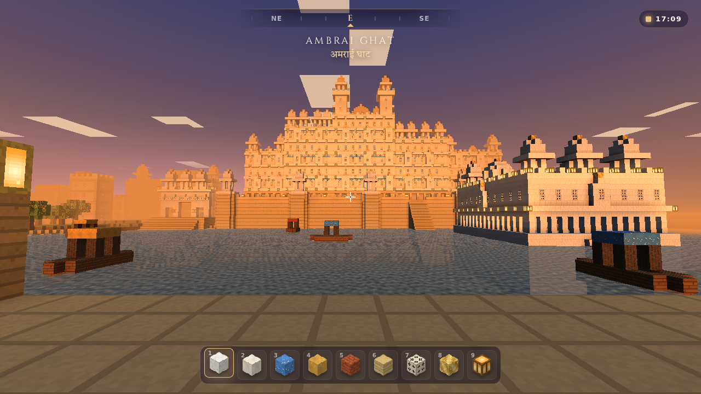
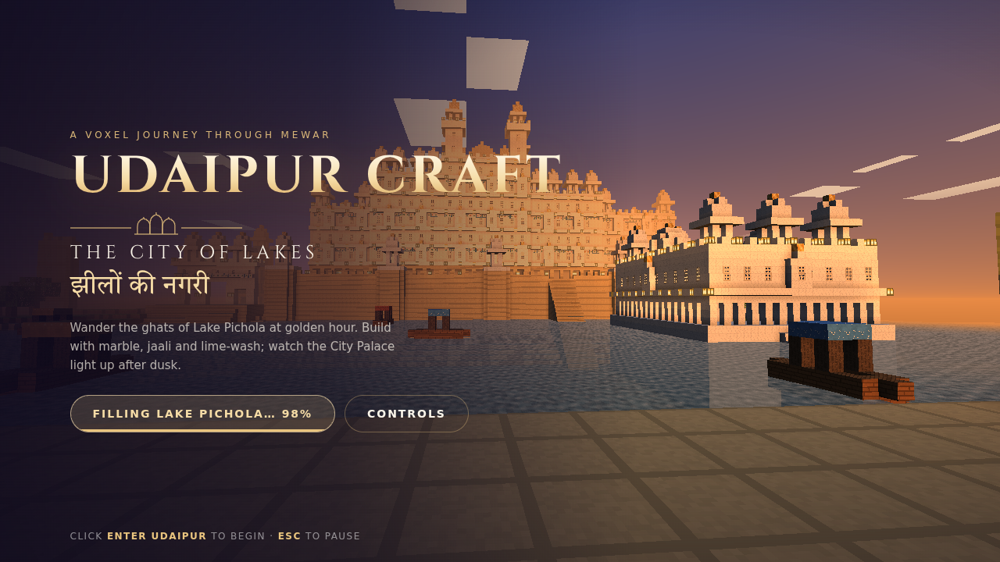
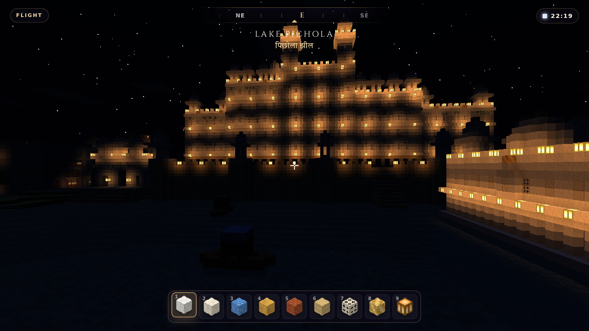
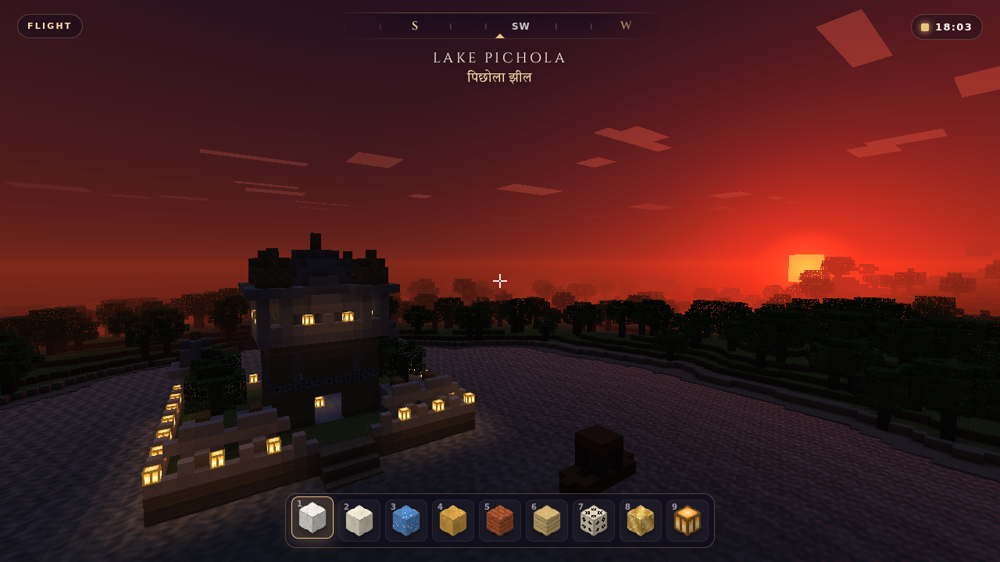
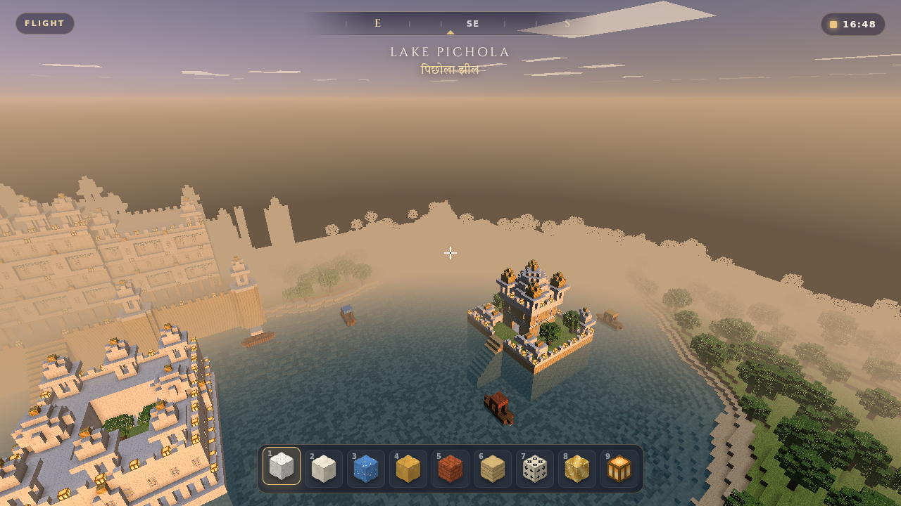

# Udaipur Craft — The City of Lakes · झीलों की नगरी

A Minecraft-style voxel open world of **Udaipur, Rajasthan**, built for the browser with
Vite, TypeScript and three.js. You start on Ambrai Ghat at golden hour, looking across
Lake Pichola at the City Palace. From there you can walk, swim or fly, and build with
marble, jaali and lime-wash.



| Title | Night: City Palace lit up | Sunset over Pichola | Aerial: Lake Palace |
|---|---|---|---|
|  |  |  |  |

## Features

- **Chunked voxel world**: 16×16×128 chunks. Chunks are generated in a Web Worker pool and
  meshed with face culling, one BufferGeometry per chunk. The world streams around you
  within the render distance (6–12 chunks, 10 by default), and far chunks are unloaded.
- **Procedural pixel-art atlas**: every 16 px texture is painted on a canvas at runtime with
  nearest filtering. The set includes grass, dirt, Aravalli stone, sand, sandstone, white
  marble, lime plaster, Rajasthani blue, haveli ochre, terracotta, sheesham wood, neem
  log and leaves, a jharokha *jaali* lattice, brass, *diya* lanterns, old-city paving and
  *pietra dura* inlay.
- **Minecraft-style lighting**: per-vertex ambient occlusion, per-face shading, sun and
  hemisphere light, and fog that picks up the sun's glow. Lantern light is baked into
  nearby faces and the water, and it glows warm after dusk.
- **Lake water**: translucent and animated, with ripples, a Fresnel sky reflection, sun
  glints and lamp reflections at night. There is also an underwater tint.
- **Day–night cycle** (20 minutes per day): a warm Rajasthan sunset palette, a "belt of
  Venus" glow, a square sun and moon, stars and drifting blocky clouds.
- **Landmarks** (stylised geography):
  - Lake Pichola, with boats
  - City Palace: five wings on the east bank, with a fortified lakeside wall, bastions,
    jharokhas, chhatris, twin towers and a great brass dome
  - Lake Palace (Jag Niwas): on its island, with arcades and a courtyard pool garden
  - Jag Mandir: on the southern island, with its marble elephants and the Gul Mahal dome
  - Ambrai Ghat and Gangaur Ghat: steps running into the water, with a triple-arched gateway at Gangaur Ghat
  - Jagdish Temple: with its shikhara
  - Sajjangarh (Monsoon Palace): on the western hilltop
  - Karni Mata temple: on Machla Magra
  - The old city: dense havelis in ochre, white and blue, with lit lanterns
  - Aravalli ridges and neem trees around the valley
- **HUD**: a compass, a label for the nearest landmark (English and Hindi), a clock, a
  flight or swimming indicator, a 9-slot hotbar with isometric block icons, and F3 debug.
- **Title screen and pause menu**: the pause menu sets the time of day, render distance
  and mouse sensitivity.

## Controls

| Key | Action |
|---|---|
| W A S D | Walk |
| Mouse | Look (click the game to capture the pointer) |
| Space | Jump · swim up |
| Shift | Sprint |
| F or double-tap Space | Toggle flight |
| Space / C (flying) | Ascend / descend |
| Left click | Break block |
| Right click | Place block |
| 1–9 / mouse wheel | Choose block |
| T (hold) | Fast-forward time |
| F3 | Debug overlay |
| Esc | Pause |

Walking into a one-block ledge, such as a ghat step, steps you up automatically.

## Run and build

```bash
npm install
npm run dev        # local dev server
npm run build      # static build to dist/ (relative base './')
npm run preview    # serve the built dist/
```

`dist/` is fully static. Serve it over HTTP, because the world generator runs in a module
Web Worker. If workers are unavailable, it falls back to generating on the main thread.

## A note on geography

The map is **stylised, not surveyed**. The landmarks keep their real relationships to each
other: the City Palace on the east bank, Jag Niwas and Jag Mandir on islands, Ambrai
looking across at the palace, and Sajjangarh on the western hill. Distances, scale and
building details are compressed and simplified so the city works as a voxel world.

## Project layout

```
src/
  main.ts        renderer, game loop, HUD, input, title/pause
  world.ts       chunk streaming, worker pool, edits, DDA raycast
  gen.ts         chunk generation (terrain columns, trees, structures)
  gen.worker.ts  worker entry
  terrain.ts     heightmap, Lake Pichola shoreline, old-city mask
  structures.ts  landmark generators + landmark list
  builder.ts     chunk-clipped writer: domes, chhatris, jharokhas, crenellations, trees
  mesher.ts      face-culled mesher with AO and lantern glow
  materials.ts   terrain / water / sky / cloud shaders
  sky.ts         day–night cycle
  atlas.ts       procedural texture atlas + hotbar icons
  noise.ts       seeded simplex / fbm / ridged noise
```

## Credits

Created by Swapnil Agrawal. Fonts: Cinzel and Tiro Devanagari Hindi (SIL OFL 1.1).
Licensed under MIT; see [LICENSE](LICENSE).
